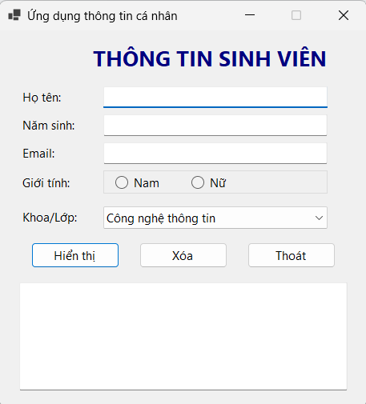
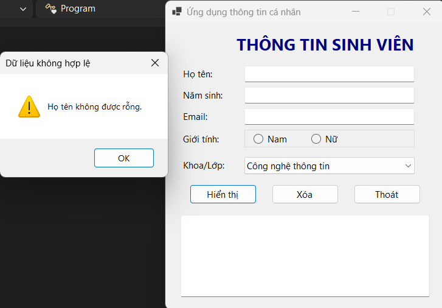
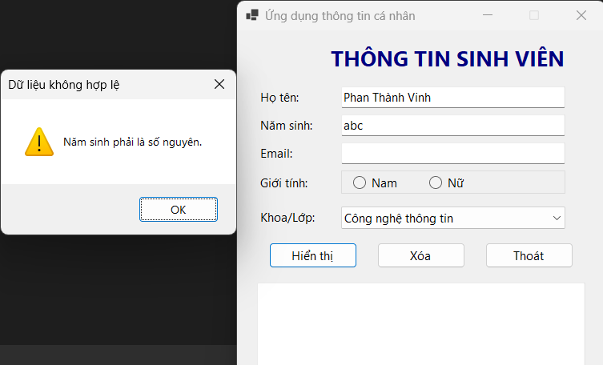
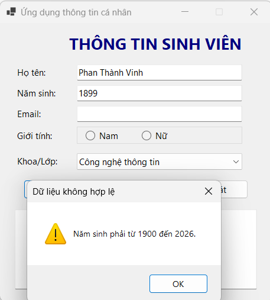
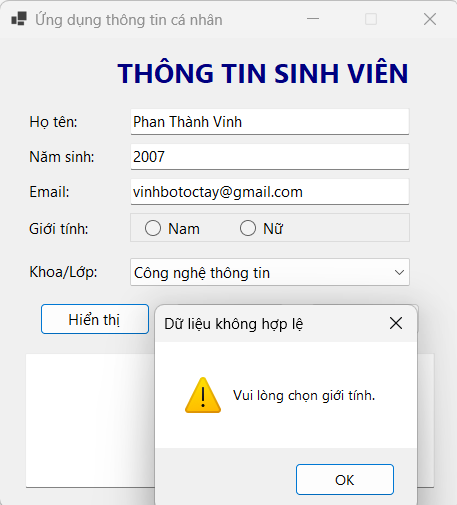
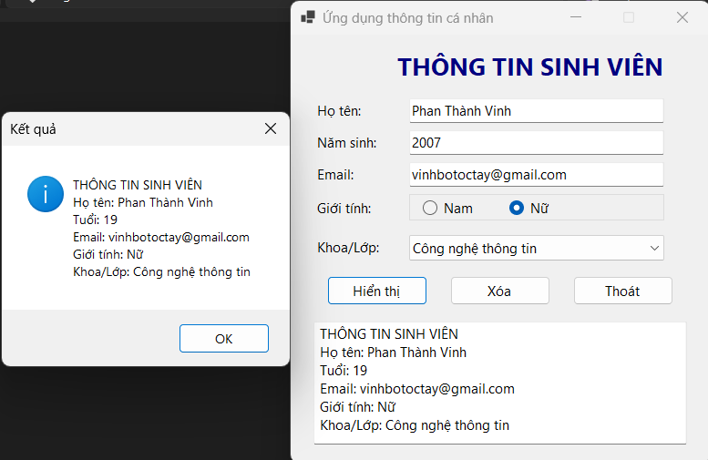
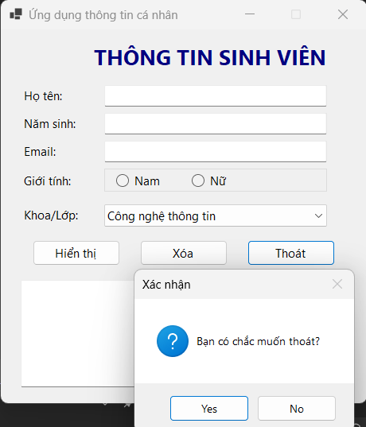

# Bài Lab 01 - Ứng Dụng Thông Tin Cá Nhân

**Học phần:** COMP1019 - Lập trình trên Windows
**Công cụ:** Visual Studio 2022+ (có workload .NET desktop development), Windows Forms App (.NET 8), C#

## Mô tả
Ứng dụng nhập thông tin cá nhân sinh viên (họ tên, năm sinh, email, giới tính, khoa/lớp), kiểm tra dữ liệu và hiển thị kết quả khi nhấn **Hiển thị**. Nút **Xóa** đưa form về trạng thái rỗng, nút **Thoát** hỏi xác nhận trước khi đóng.

## Cấu trúc project
- `Program.cs` — điểm khởi chạy
- `FrmThongTin.cs` — giao diện, xử lý sự kiện và kiểm tra dữ liệu

## Cách chạy
1. Mở `Lab01_ThongTinCaNhan.csproj` bằng Visual Studio.
2. Nhấn F5 để build và chạy.

## Kết quả

### 1. Giao diện khi mới mở chương trình
Form có tiêu đề, 3 ô nhập (Họ tên, Năm sinh, Email), chọn giới tính, ComboBox khoa/lớp (4 lựa chọn), 3 nút lệnh và khung kết quả.

### 2. Kiểm tra khi bỏ trống dữ liệu
Nhấn **Hiển thị** khi chưa nhập gì, chương trình báo "Họ tên không được rỗng." và đưa con trỏ về ô họ tên.

### 3. Năm sinh không phải số nguyên
Nhập năm sinh `abc`, chương trình báo "Năm sinh phải là số nguyên."

### 4. Năm sinh ngoài khoảng cho phép
Nhập năm sinh `1899`, chương trình báo năm sinh phải từ 1900 đến năm hiện tại.

### 5. Chưa chọn giới tính
Nhập đủ dữ liệu nhưng không chọn Nam/Nữ, chương trình báo "Vui lòng chọn giới tính."

### 6. Hiển thị kết quả hợp lệ
Nhập Nguyễn Văn A, 2005, vana@example.com, Nam, Công nghệ thông tin. Kết quả hiện trong MessageBox và khung phía dưới (Tuổi = năm hiện tại - 2005).

### 7. Nút Xóa và Thoát
**Xóa** làm rỗng toàn bộ ô nhập, bỏ chọn giới tính, đưa ComboBox về lựa chọn đầu. **Thoát** hiện hộp thoại xác nhận Yes/No.

