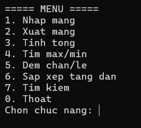
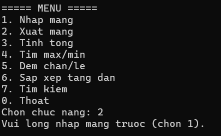
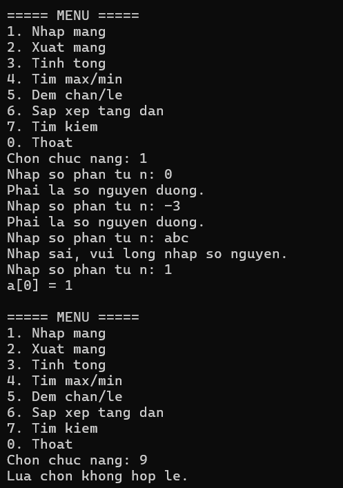
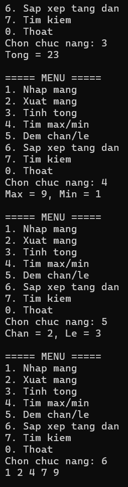
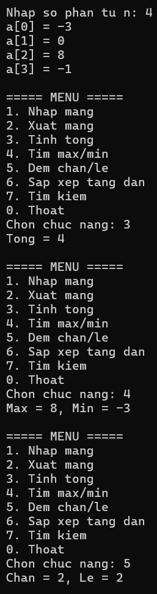
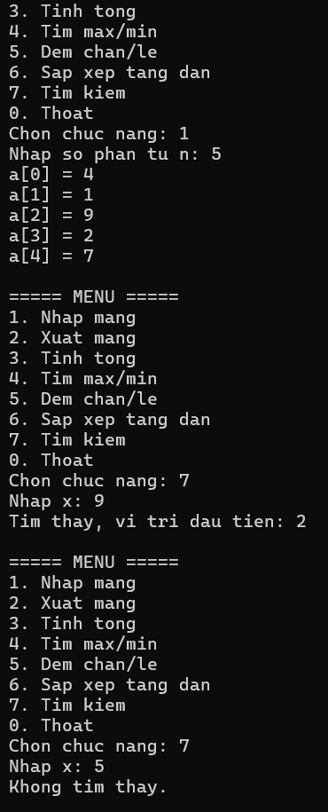

# Bài Lab 02 - Quản Lý Mảng Số Nguyên (Console)

**Học phần:** COMP1019 - Lập trình trên Windows
**Công cụ:** Visual Studio 2022+, Console App (.NET 8), C#

## Mô tả
Chương trình Console quản lý mảng số nguyên qua menu: nhập, xuất, tính tổng, tìm max/min, đếm chẵn/lẻ, sắp xếp tăng dần, tìm kiếm. Chương trình lặp lại menu đến khi chọn `0`.

## Cấu trúc project
- `Program.cs` — menu và các hàm xử lý (NhapSoNguyen, NhapMang, XuatMang, TinhTong, TimMax, TimMin, DemChan, DemLe, SapXepTangDan, TimKiem)

## Cách chạy
1. Mở `Lab02_MangSoNguyen.csproj` bằng Visual Studio.
2. Nhấn F5, hoặc chạy `dotnet run` trong thư mục project.

## Kết quả

### 1. Menu chương trình
Hiển thị menu 7 chức năng và `0. Thoat`.

### 2. Chưa nhập mảng
Chọn chức năng 2-7 khi chưa nhập mảng, chương trình báo "Vui lòng nhap mang truoc (chon 1)."

### 3. Kiểm tra dữ liệu nhập
Nhập `n = 0`, `n = -3` hoặc `abc`, chương trình yêu cầu nhập lại. Chọn menu ngoài 0-7 báo "Lua chon khong hop le."

### 4. Mảng 4 1 9 2 7
Tổng = 23, Max = 9, Min = 1, Chẵn = 2, Lẻ = 3. Sắp xếp tăng dần cho `1 2 4 7 9`.

### 5. Mảng -3 0 8 -1
Tổng = 4, Max = 8, Min = -3, Chẵn = 2, Lẻ = 2.

### 6. Tìm kiếm
Tìm `x = 9` trong `4 1 9 2 7` báo vị trí đầu tiên là 2 (tính từ 0). Tìm `x = 5` báo "Khong tim thay."

