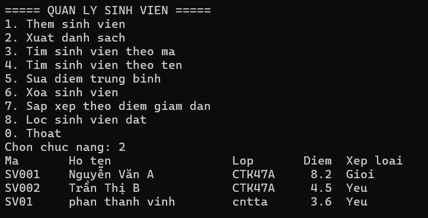
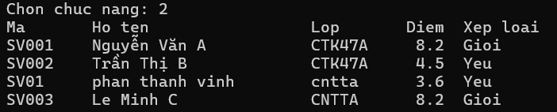
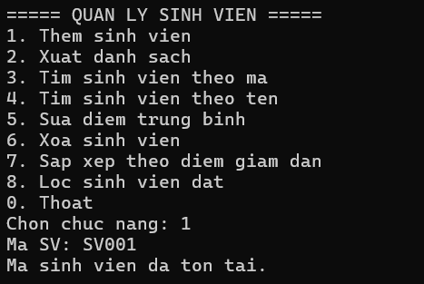
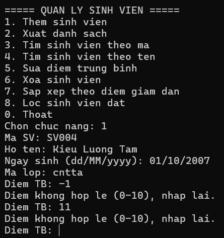
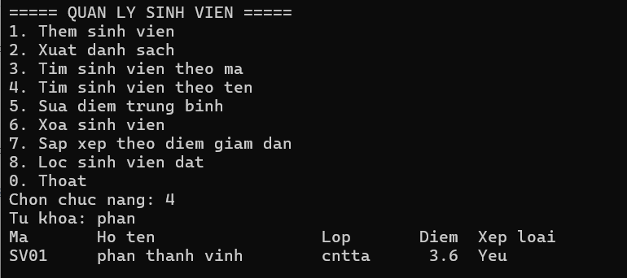
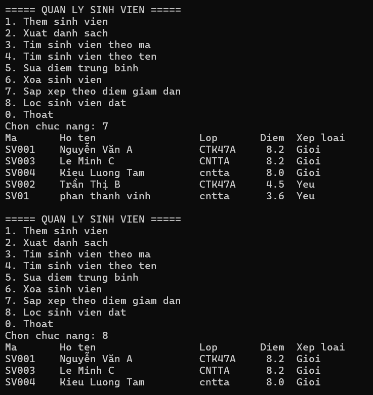
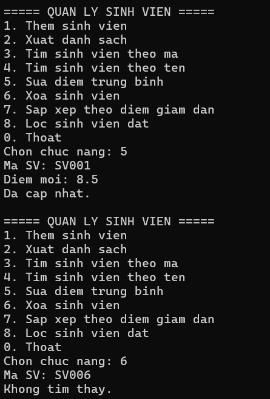

# Bài Lab 03 - Quản Lý Sinh Viên OOP (Console)

**Học phần:** COMP1019 - Lập trình trên Windows
**Công cụ:** Visual Studio 2022+, Console App (.NET 8), C#

## Mô tả
Chương trình Console quản lý sinh viên theo hướng đối tượng: `SinhVien` kế thừa `Nguoi`, danh sách lưu bằng `List<SinhVien>` trong `QuanLySinhVien`, tìm kiếm/lọc/sắp xếp bằng LINQ. Chương trình có sẵn 2 sinh viên mẫu (SV001 - 8.2, SV002 - 4.5).

## Cấu trúc project
- `Nguoi.cs` — lớp cha: HoTen, NgaySinh, LayThongTin() (virtual)
- `SinhVien.cs` — kế thừa Nguoi: MaSinhVien, MaLop, DiemTrungBinh (kiểm tra 0-10), XepLoai(), override LayThongTin()
- `QuanLySinhVien.cs` — Them, Sua, Xoa, TimTheoMa, TimTheoTen, SapXepTheoDiem, LocDat, LayDanhSach
- `Program.cs` — menu và các hàm nhập dữ liệu

## Cách chạy
1. Mở `Lab03_QuanLySinhVienOOP.csproj` bằng Visual Studio.
2. Nhấn F5, hoặc chạy `dotnet run` trong thư mục project.

## Kết quả

### 1. Menu và danh sách sinh viên
Chọn 2 để in danh sách gồm mã, họ tên, lớp, điểm và xếp loại.

### 2. Thêm sinh viên mới
Thêm `SV003, Lê Minh C, 8.2` thêm thành công, xếp loại Giỏi.

### 3. Thêm trùng mã
Thêm lại mã `SV001`, chương trình báo "Ma sinh vien da ton tai."

### 4. Điểm không hợp lệ
Nhập điểm `-1` hoặc `11`, chương trình báo điểm không hợp lệ và yêu cầu nhập lại.

### 5. Tìm kiếm
Tìm theo tên với từ khóa `phan` in ra các sinh viên có họ tên chứa từ khóa. Tìm theo mã in thông tin sinh viên.

### 6. Sắp xếp và lọc
Chọn 7 sắp xếp điểm giảm dần, chọn 8 chỉ in sinh viên điểm từ 5 trở lên.

### 7. Sửa điểm và xóa
Sửa điểm theo mã. Xóa mã không tồn tại báo "Khong tim thay."

