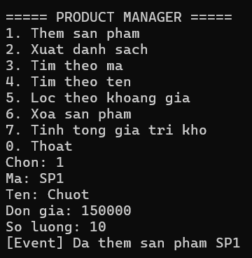
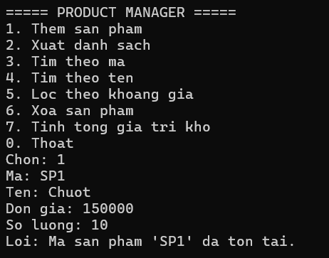
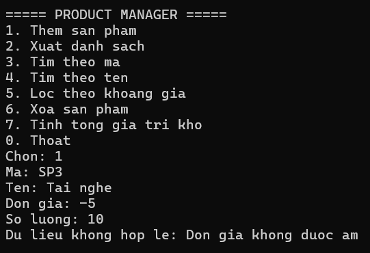
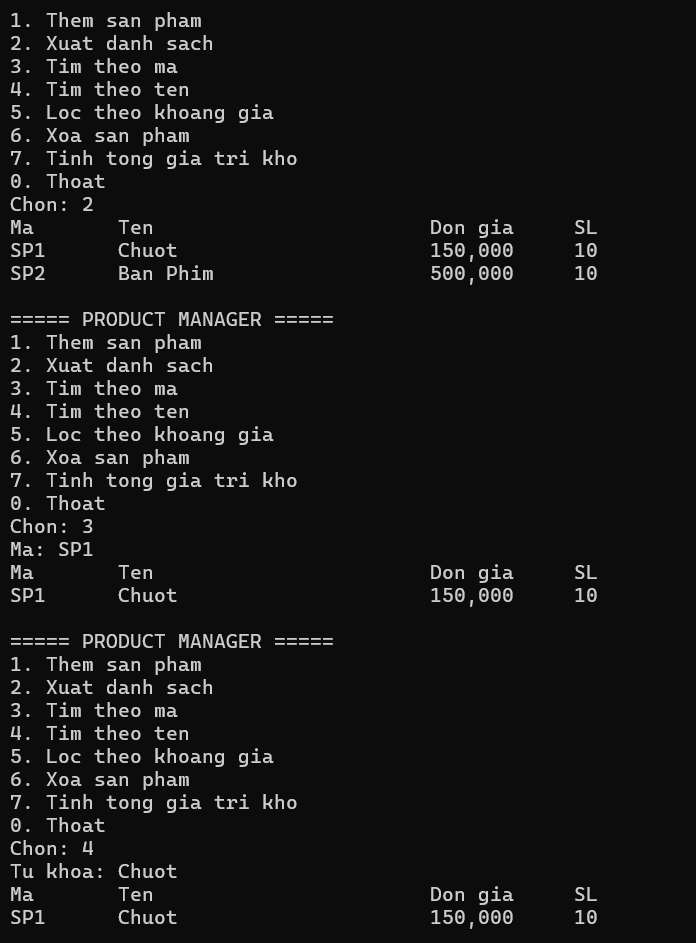
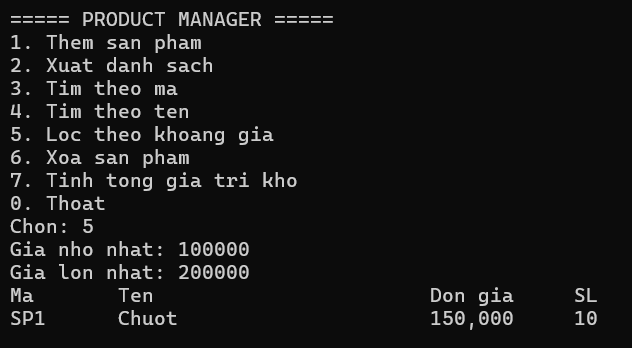
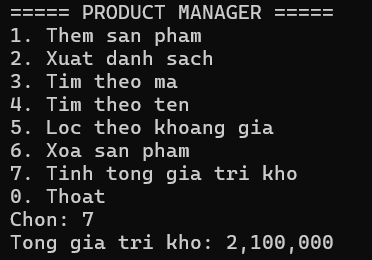
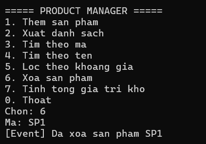

# Bài Lab 04 - Exception, Event, Func và Generic (Console)

**Học phần:** COMP1019 - Lập trình trên Windows
**Công cụ:** Visual Studio 2022+, Console App (.NET 8), C#

## Mô tả
Chương trình Console quản lý sản phẩm trong bộ nhớ bằng `Repository<T>` (generic, ràng buộc `where T : IEntity`). Dùng 2 exception tự tạo, event khi thêm/xóa thành công và `Func<Product,bool>` để lọc/tìm kiếm.

## Cấu trúc project
- `IEntity.cs` — interface có `string Id`
- `Product.cs` — MaSP, TenSP, Price, Quantity (không được âm)
- `Exceptions.cs` — DuplicateProductException, ProductNotFoundException
- `Repository.cs` — Add, Remove, FindById, Find(Func), GetAll
- `ProductService.cs` — kiểm tra nghiệp vụ, phát event ProductAdded/ProductRemoved
- `Program.cs` — menu, nhập xuất, bắt exception

## Cách chạy
1. Mở `Lab04_ProductManager.csproj` bằng Visual Studio.
2. Nhấn F5, hoặc chạy `dotnet run` trong thư mục project.

## Kết quả

### 1. Thêm sản phẩm và event
Thêm `SP1, Chuot, 150000, 10` in thông báo `[Event] Da them san pham SP1`.

### 2. Trùng mã sản phẩm
Thêm lại `SP1`, chương trình báo "Loi: Ma san pham 'SP1' da ton tai."

### 3. Đơn giá âm
Nhập đơn giá `-5`, chương trình báo "Du lieu khong hop le: Don gia khong duoc am".

### 4. Xuất danh sách và tìm kiếm
Xuất toàn bộ danh sách, tìm theo mã và theo tên.

### 5. Lọc theo khoảng giá
Nhập giá từ 100000 đến 200000, chỉ in sản phẩm trong khoảng (dùng `Func<Product,bool>`).

### 6. Tổng giá trị kho
Với `SP1` (150000 x 10) và `SP2` (300000 x 2), tổng = 2,100,000.

### 7. Xóa sản phẩm
Xóa `SP1` in `[Event] Da xoa san pham SP1`. Xóa mã không tồn tại báo "Loi: Khong tim thay san pham 'SP9'."

