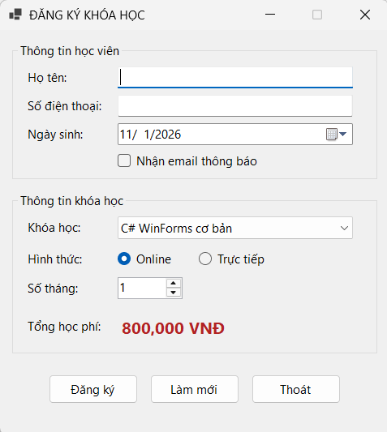
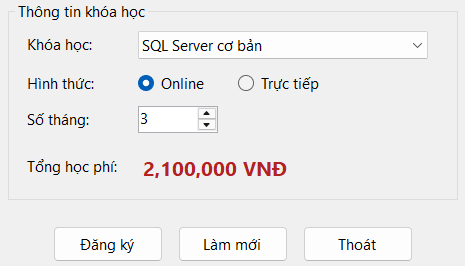
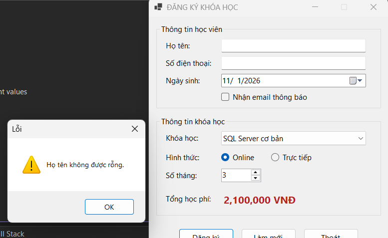
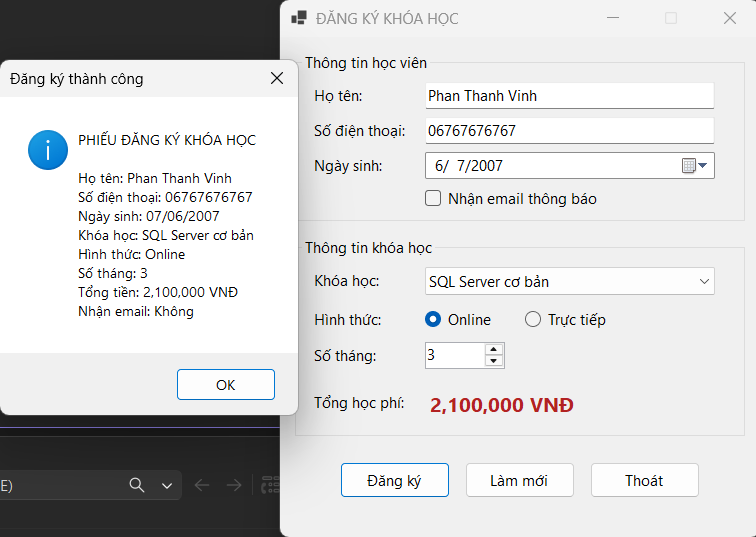
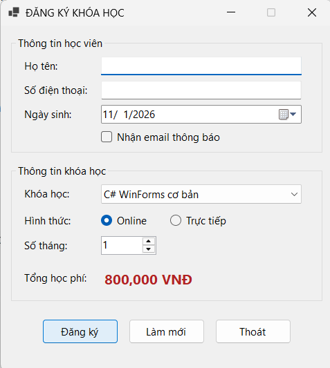
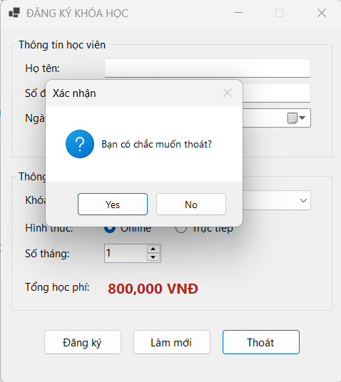

# Bài Lab 05 - Windows Forms Cơ Bản (CourseRegistrationApp)

**Học phần:** COMP1019 - Lập trình trên Windows
**Công cụ:** Visual Studio 2022+ (có workload .NET desktop development), Windows Forms App (.NET 8), C#

## Mô tả
Ứng dụng đăng ký khóa học: nhập thông tin học viên, chọn khóa học, hình thức học và số tháng; học phí tự tính lại khi đổi khóa học hoặc số tháng.

## Cấu trúc project
- `Program.cs` — điểm khởi chạy
- `FrmDangKy.cs` — giao diện (2 GroupBox), xử lý Load, Đăng ký, Làm mới, Thoát

## Cách chạy
1. Mở `CourseRegistrationApp.csproj` bằng Visual Studio.
2. Nhấn F5 để build và chạy.

## Kết quả

### 1. Giao diện khi mở chương trình
Khóa học đầu tiên (C# WinForms cơ bản) được chọn, hình thức Online, 1 tháng, tổng học phí ban đầu 800,000 VNĐ.

### 2. Tính học phí khi đổi khóa học hoặc số tháng
Chọn SQL Server cơ bản, 3 tháng, tổng tiền cập nhật thành 2,100,000 VNĐ.

### 3. Kiểm tra dữ liệu
Để trống họ tên hoặc số điện thoại, chương trình báo lỗi và đưa con trỏ về ô tương ứng.

### 4. Phiếu đăng ký
Nhập đủ dữ liệu và nhấn **Đăng ký**, MessageBox hiển thị họ tên, số điện thoại, ngày sinh, khóa học, hình thức, số tháng, tổng tiền và trạng thái nhận email.

### 5. Nút Làm mới
Xóa họ tên, số điện thoại, bỏ chọn nhận email, về khóa học đầu, Online, 1 tháng, con trỏ về ô họ tên.

### 6. Nút Thoát
Hiện hộp thoại xác nhận, chỉ đóng Form khi chọn Yes.

