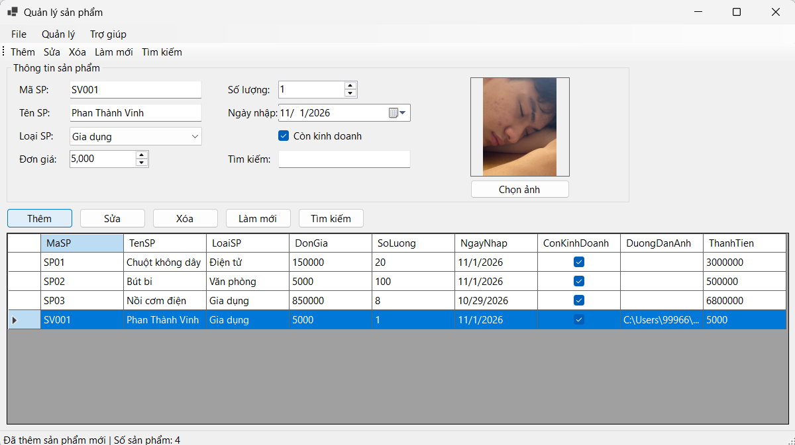
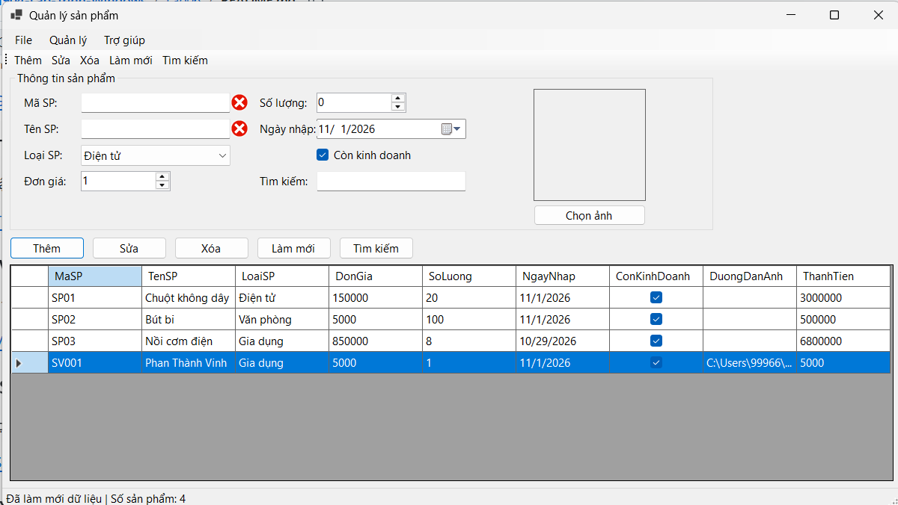
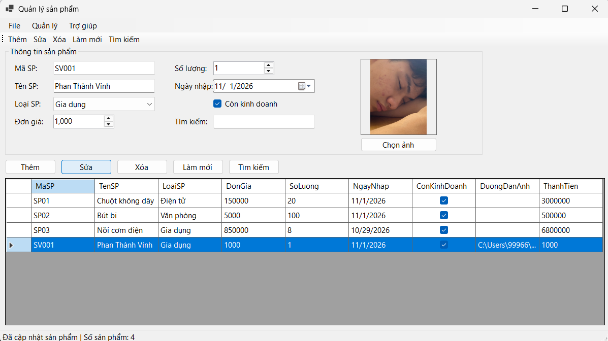
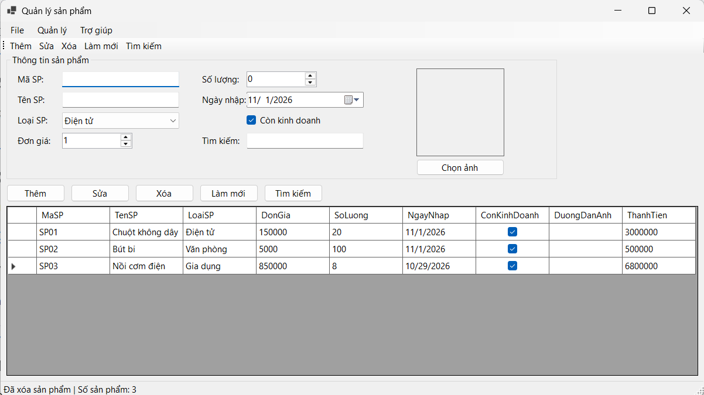
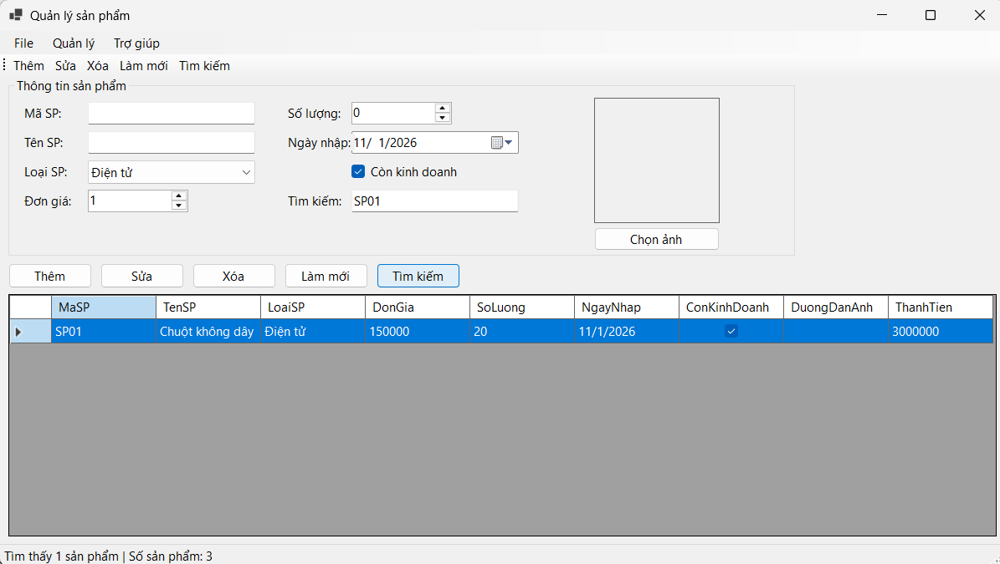
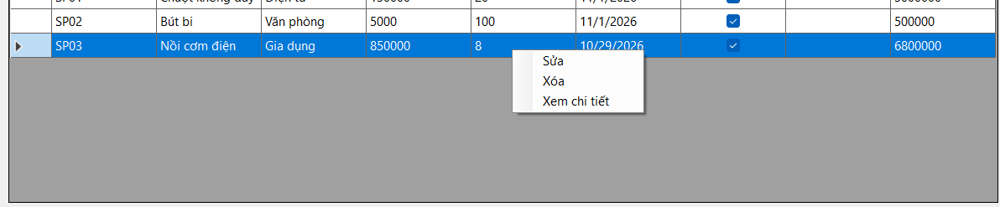

# Bài Lab 06 - DataGridView và CRUD Trong Bộ Nhớ (ProductManager)

**Học phần:** COMP1019 - Lập trình trên Windows
**Công cụ:** Visual Studio 2022+ (có workload .NET desktop development), Windows Forms App (.NET 8), C#

## Mô tả
Ứng dụng quản lý sản phẩm dùng `Product` + `BindingList<Product>` + `BindingSource`, hiển thị bằng DataGridView, kiểm tra dữ liệu bằng `ErrorProvider`, có MenuStrip, ToolStrip, StatusStrip, ContextMenuStrip và chọn ảnh bằng OpenFileDialog. Chưa kết nối SQL Server.

## Cấu trúc project
- `Program.cs` — điểm khởi chạy
- `Product.cs` — lớp sản phẩm, thuộc tính tính toán ThanhTien
- `FrmProduct.cs` — giao diện và toàn bộ xử lý

## Cách chạy
1. Mở `ProductManager.csproj` bằng Visual Studio.
2. Nhấn F5 để build và chạy.

## Kết quả

### 1. Giao diện và dữ liệu mẫu
Form có menu, toolbar, status bar, nhóm nhập liệu và DataGridView với 3 sản phẩm mẫu. StatusStrip hiển thị số sản phẩm.

### 2. Thêm sản phẩm
Nhập đủ dữ liệu và nhấn Thêm, sản phẩm xuất hiện trong lưới, status cập nhật.

### 3. Validation (ErrorProvider)
Để trống mã, nhập mã trùng, đơn giá bằng 0 hoặc ngày nhập lớn hơn hôm nay, biểu tượng lỗi hiện cạnh control tương ứng.

### 4. Sửa sản phẩm
Chọn một dòng, dữ liệu đưa lên form, chỉnh sửa và nhấn Sửa, lưới cập nhật. Nhấn Sửa khi chưa chọn dòng chỉ hiện thông báo.

### 5. Xóa sản phẩm
Hiện hộp thoại xác nhận trước khi xóa.

### 6. Tìm kiếm và làm mới
Tìm theo một phần mã hoặc tên (không phân biệt hoa thường); **Làm mới** hiển thị lại toàn bộ.

### 7. Menu chuột phải và chọn ảnh
ContextMenuStrip có Sửa, Xóa, Xem chi tiết; chọn ảnh hiển thị trong PictureBox.

