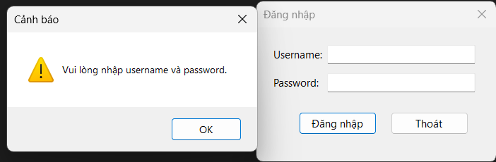
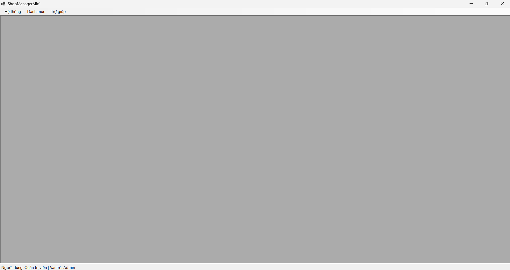
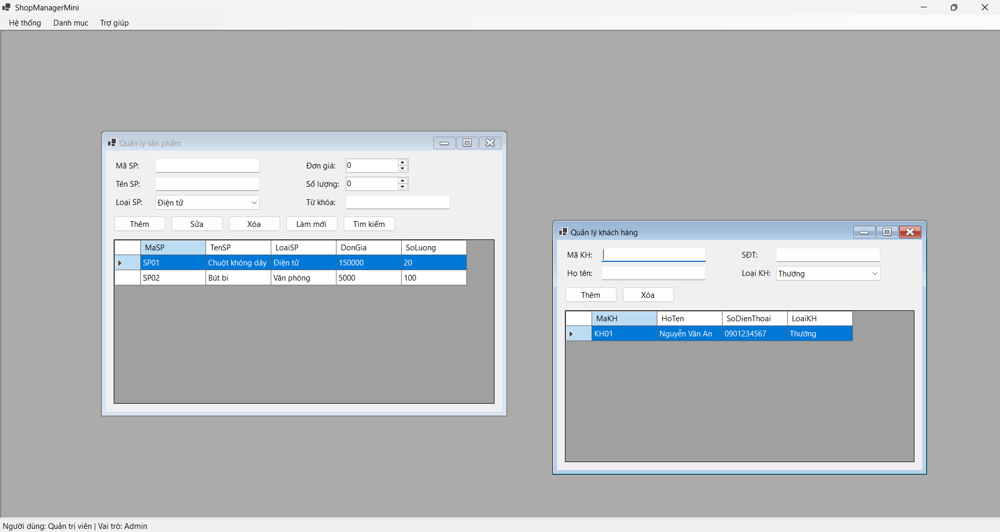
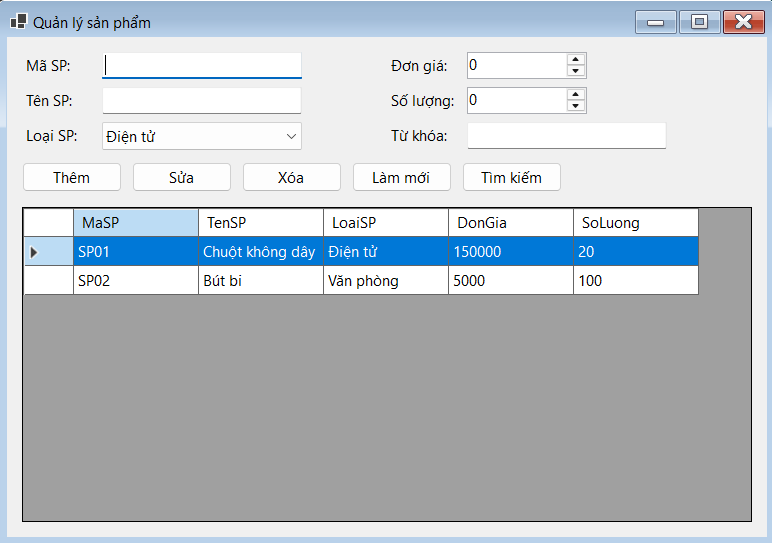
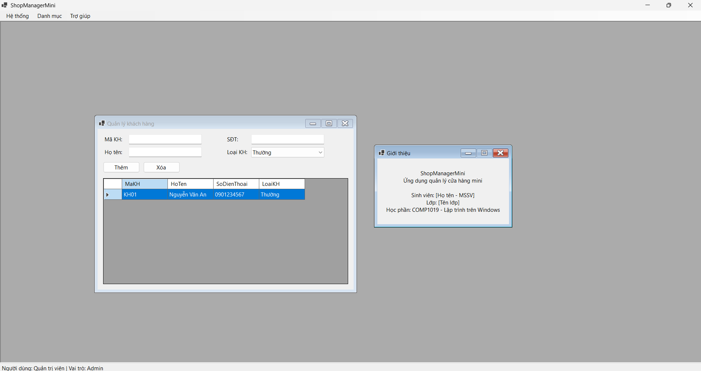
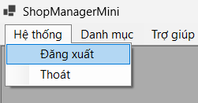

# Bài Lab 07 - SDI, MDI và Ứng Dụng Nhiều Form (ShopManagerMini)

**Học phần:** COMP1019 - Lập trình trên Windows
**Công cụ:** Visual Studio 2022+ (có workload .NET desktop development), Windows Forms App (.NET 8), C#

## Mô tả
Ứng dụng quản lý cửa hàng mini nhiều Form: đăng nhập (`ShowDialog`), Form chính MDI Parent có MenuStrip/StatusStrip, quản lý sản phẩm (CRUD trong bộ nhớ) và khách hàng. Tài khoản mẫu: `admin/123` (Admin), `user/123` (User).

## Cấu trúc project
- `Program.cs` — vòng lặp đăng nhập - Form chính (hỗ trợ đăng xuất)
- `Models/` — User, Product, Customer, Data (dữ liệu trong bộ nhớ)
- `Forms/FrmLogin.cs` — đăng nhập, trả DialogResult.OK
- `Forms/FrmMain.cs` — MDI Parent, menu, status (người dùng, vai trò, giờ)
- `Forms/FrmProduct.cs` — CRUD sản phẩm
- `Forms/FrmCustomer.cs` — thêm/xóa/hiển thị khách hàng
- `Forms/FrmAbout.cs` — giới thiệu (nhớ điền tên và lớp của bạn)

## Cách chạy
1. Mở `ShopManagerMini.csproj` bằng Visual Studio.
2. Nhấn F5 để build và chạy.

## Kết quả

### 1. Form đăng nhập
Bỏ trống username/password báo cảnh báo, sai tài khoản báo lỗi.

### 2. Form chính MDI
Đăng nhập thành công, StatusStrip hiển thị tên người dùng và vai trò.

### 3. Form con không mở trùng
Bấm menu Quản lý sản phẩm nhiều lần chỉ kích hoạt Form cũ, không tạo Form mới.

### 4. Quản lý sản phẩm
Thêm, sửa, xóa (có xác nhận), tìm kiếm; chặn trùng mã và số âm.

### 5. Quản lý khách hàng và Giới thiệu
Thêm khách hàng hiển thị trên DataGridView; Form Giới thiệu hiển thị tên sinh viên, lớp.

### 6. Đăng xuất và thoát
Đăng xuất quay lại Form đăng nhập, thoát hỏi xác nhận bằng MessageBox.

## Câu hỏi nộp kèm

1. **SDI và MDI khác nhau như thế nào?** SDI mỗi cửa sổ là một Form độc lập, chỉ làm việc trên một tài liệu. MDI có một Form cha (`IsMdiContainer = true`) chứa nhiều Form con bên trong, dùng chung menu/status của Form cha.
2. **Vì sao Form đăng nhập nên dùng ShowDialog()?** ShowDialog mở dạng modal, chặn chương trình cho đến khi Form đóng và trả `DialogResult`, nên Program biết đăng nhập thành công (OK) hay không trước khi mở Form chính.
3. **Dữ liệu user được truyền từ FrmLogin sang FrmMain bằng cách nào?** FrmLogin lưu user vào property `CurrentUser`; Program đọc property này rồi truyền vào constructor `new FrmMain(user)`.
4. **Bấm menu sản phẩm nhiều lần thì xử lý thế nào để không mở trùng?** Dùng `MdiChildren.OfType<T>().FirstOrDefault()`; nếu đã có thì `Activate()`, chưa có mới tạo Form với `MdiParent = this`.
5. **Khi nào dùng constructor, khi nào dùng property để truyền dữ liệu giữa các Form?** Constructor cho dữ liệu bắt buộc để Form hoạt động (như user của FrmMain); property cho dữ liệu tùy chọn hoặc để lấy kết quả sau khi Form đóng (như `CurrentUser`).
