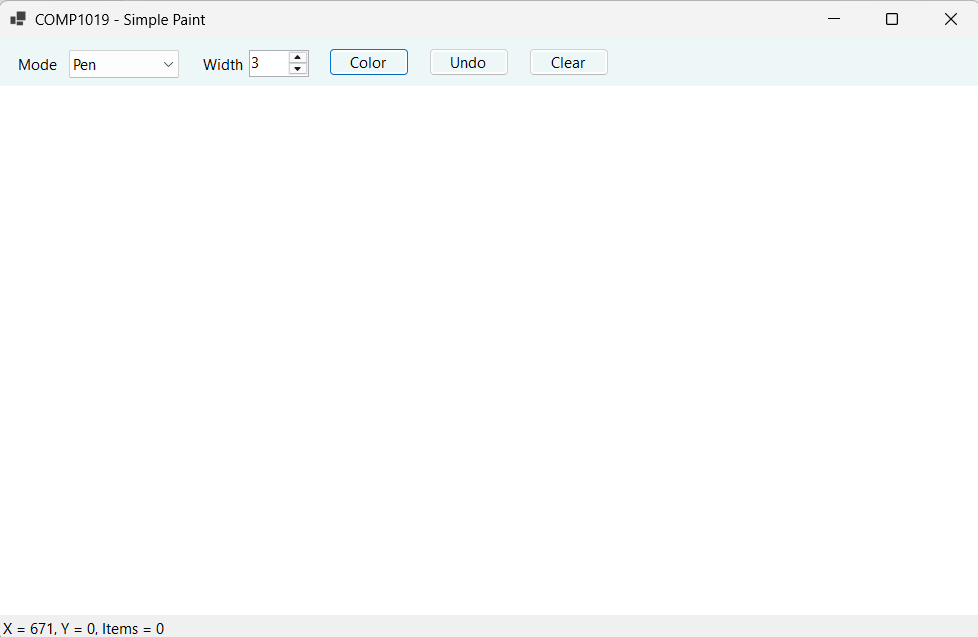
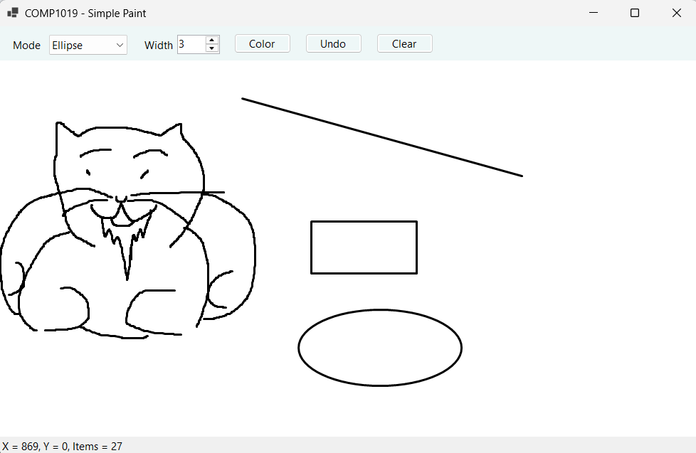
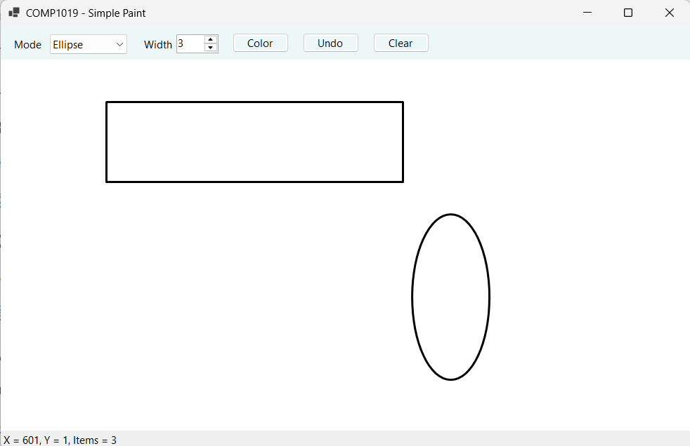
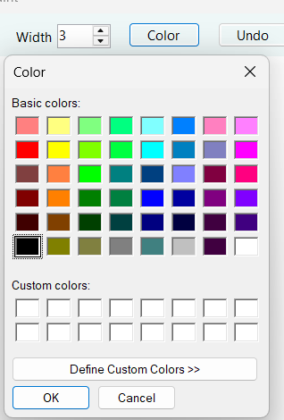
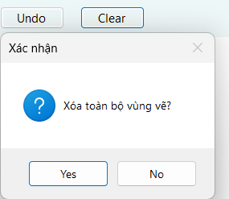
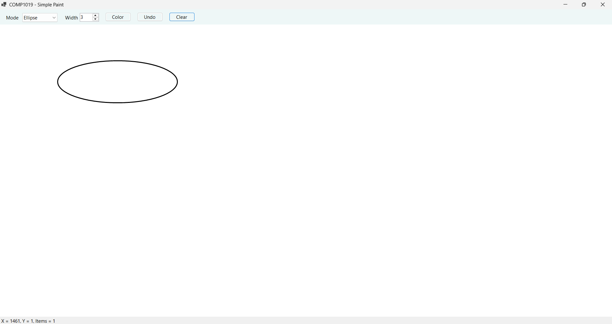

# Bài Lab 08 - Simple Paint Bằng WinForms và GDI+

**Học phần:** COMP1019 - Lập trình trên Windows
**Công cụ:** Visual Studio 2022+ (có workload .NET desktop development), Windows Forms App (.NET 8), C#

## Mô tả
Ứng dụng Paint đơn giản: vẽ tự do, đường thẳng, hình chữ nhật, ellipse; chọn màu, độ dày; Undo, Clear. Các nét vẽ lưu trong `List<DrawItem>` và vẽ lại trong sự kiện Paint nên không mất khi resize. Có thêm phím tắt Ctrl+Z.

## Cấu trúc project
- `Program.cs` — điểm khởi chạy
- `DrawMode.cs` — enum Pen, Line, Rectangle, Ellipse
- `DrawItem.cs` — dữ liệu một nét vẽ
- `DrawSurface.cs` — Panel bật DoubleBuffered
- `FrmPaint.cs` — giao diện, xử lý chuột, Paint

## Cách chạy
1. Mở `COMP1019_Lab08_SimplePaint.csproj` bằng Visual Studio.
2. Nhấn F5 để build và chạy.

## Kết quả

### 1. Giao diện chương trình
Thanh công cụ gồm Mode, Width, Color, Undo, Clear; status hiển thị tọa độ chuột và số nét vẽ.

### 2. Bốn loại hình
Vẽ thử Pen, Line, Rectangle, Ellipse trên canvas.

### 3. Kéo chuột nhiều hướng
Rectangle và Ellipse vẽ đúng khi kéo từ phải sang trái hoặc từ dưới lên trên.

### 4. Màu và độ dày
Đổi màu bằng ColorDialog và độ dày bằng NumericUpDown, chỉ nét mới dùng giá trị mới.

### 5. Undo và Clear
Undo xóa nét cuối (không lỗi khi chưa có nét); Clear hỏi xác nhận trước khi xóa toàn bộ.

### 6. Resize Form
Thay đổi kích thước hoặc che rồi hiện lại cửa sổ, các hình đã vẽ không bị mất.

