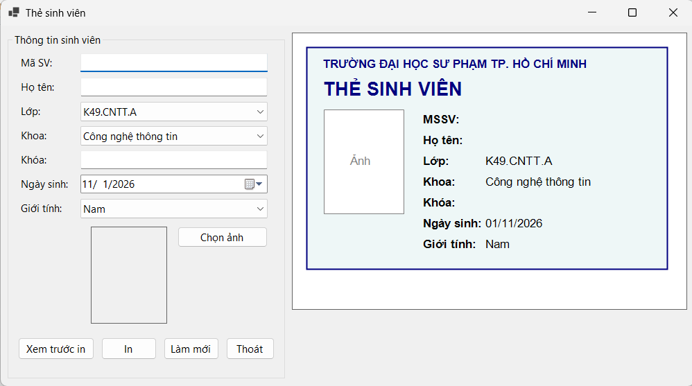
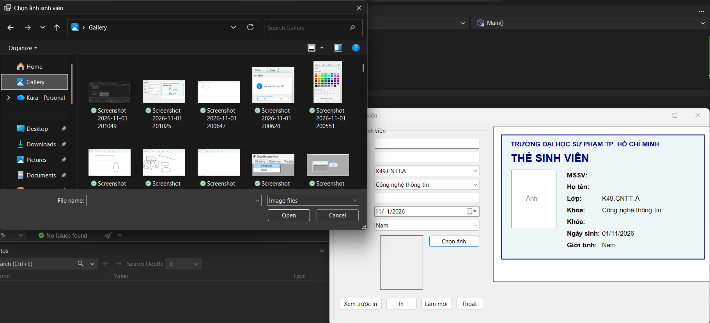
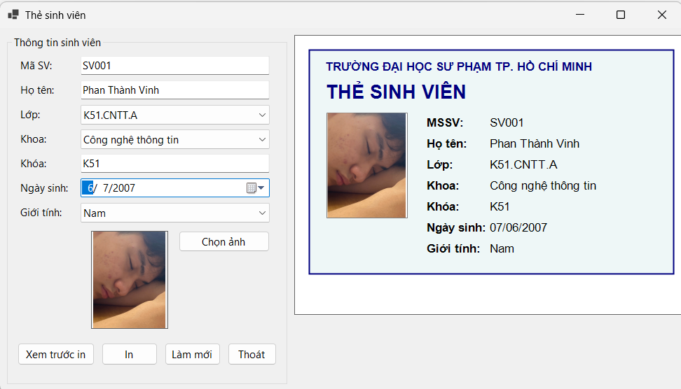
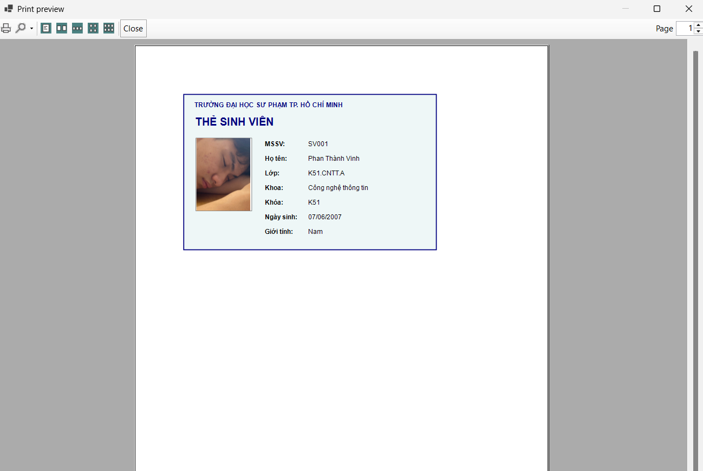
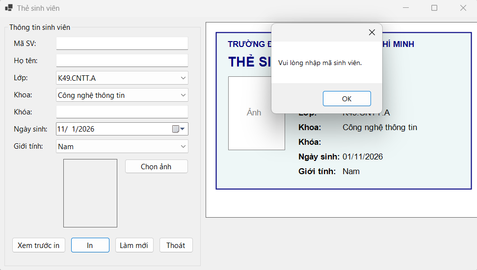
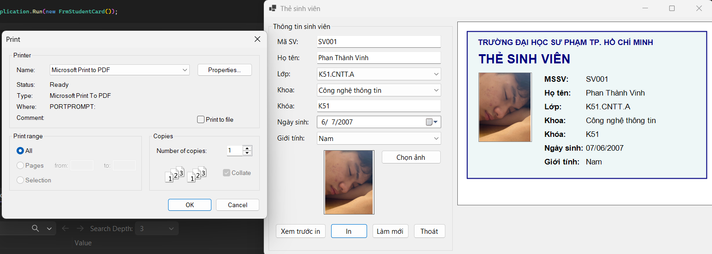

# Bài Lab 09 - Thiết Kế và In Thẻ Sinh Viên Bằng WinForms

**Học phần:** COMP1019 - Lập trình trên Windows
**Công cụ:** Visual Studio 2022+ (có workload .NET desktop development), Windows Forms App (.NET 8), C#

## Mô tả
Ứng dụng nhập thông tin sinh viên, chọn ảnh, xem trước thẻ trên Panel bằng GDI+ và in bằng `PrintDocument`/`PrintPreviewDialog`. Một hàm `DrawCard` dùng chung cho preview và bản in.

## Cấu trúc project
- `Program.cs` — điểm khởi chạy
- `StudentCardInfo.cs` — dữ liệu thẻ
- `FrmStudentCard.cs` — giao diện, vẽ thẻ, chọn ảnh, preview, in

## Cách chạy
1. Mở `StudentCardPrinter.csproj` bằng Visual Studio.
2. Nhấn F5 để build và chạy.

## Kết quả

### 1. Giao diện chính
Bên trái nhập liệu, bên phải preview thẻ tự cập nhật khi nhập.

### 2. Chọn ảnh
Chọn file JPG/PNG/BMP, ảnh hiển thị trong PictureBox (Zoom) và trên thẻ, không méo.

### 3. Preview thẻ
Thẻ có khung, tiêu đề, ảnh và đầy đủ thông tin sinh viên.

### 4. Print Preview
Bấm **Xem trước in** mở PrintPreviewDialog hiển thị thẻ.

### 5. Validation
Thiếu mã sinh viên, họ tên hoặc ảnh thì không cho xem trước/in.

### 6. In ra PDF
Chọn Microsoft Print to PDF để kiểm tra bản in.

## Test case

| STT | Tình huống | Kết quả mong đợi |
| --- | --- | --- |
| 1 | Mở chương trình | Form hiển thị đúng, ComboBox có giá trị mặc định |
| 2 | Nhập mã sinh viên và họ tên | Preview cập nhật ngay |
| 3 | Chọn ảnh JPG hợp lệ | Ảnh hiện trên PictureBox và thẻ |
| 4 | Chọn file không phải ảnh | Thông báo "File được chọn không phải ảnh hợp lệ." |
| 5 | Đổi ảnh nhiều lần | Không lỗi, không treo, không khóa file ảnh cũ |
| 6 | Xem trước in khi thiếu mã sinh viên | Báo "Vui lòng nhập mã sinh viên.", không mở preview |
| 7 | Xem trước in khi chưa chọn ảnh | Báo "Vui lòng chọn ảnh sinh viên." |
| 8 | Xem trước in khi đủ dữ liệu | Thẻ hiển thị đúng, ảnh không méo |
| 9 | In bằng Microsoft Print to PDF | Tạo file PDF chứa thẻ |
| 10 | Bấm Làm mới | Dữ liệu và ảnh được xóa, preview về trạng thái ban đầu |
