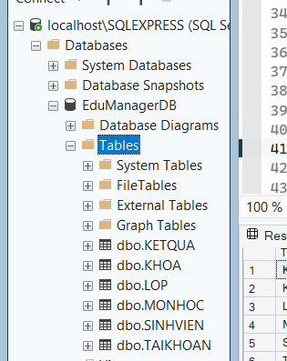
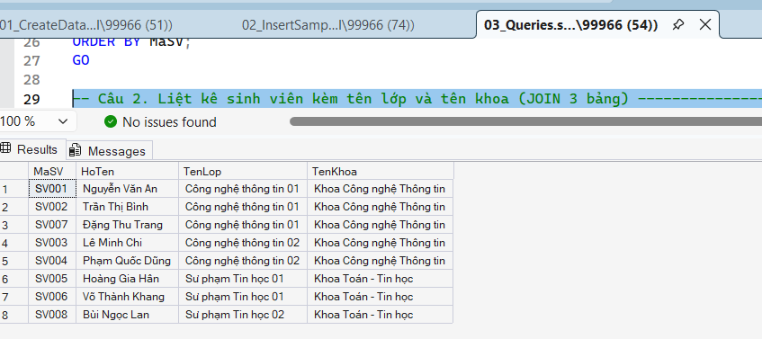
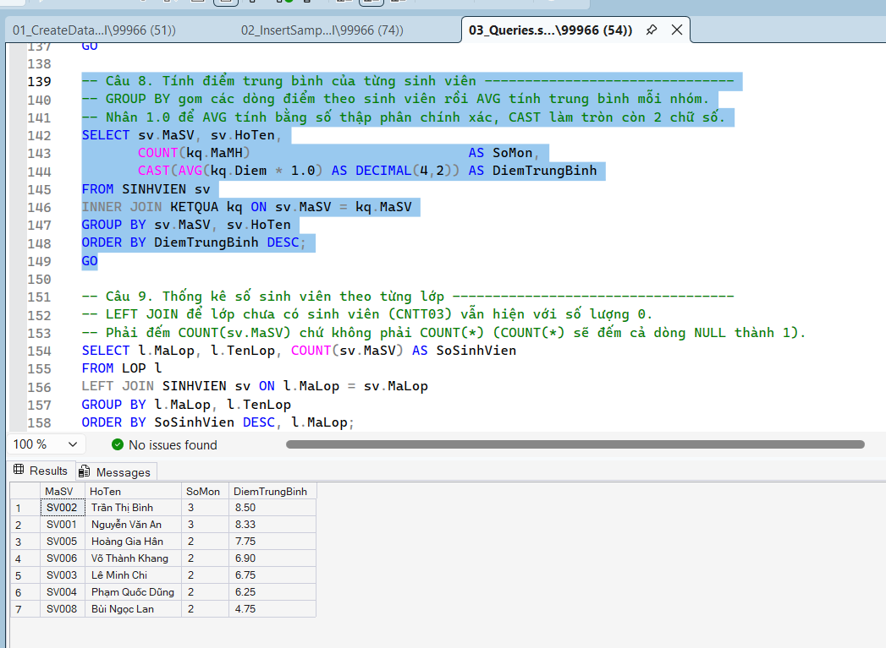
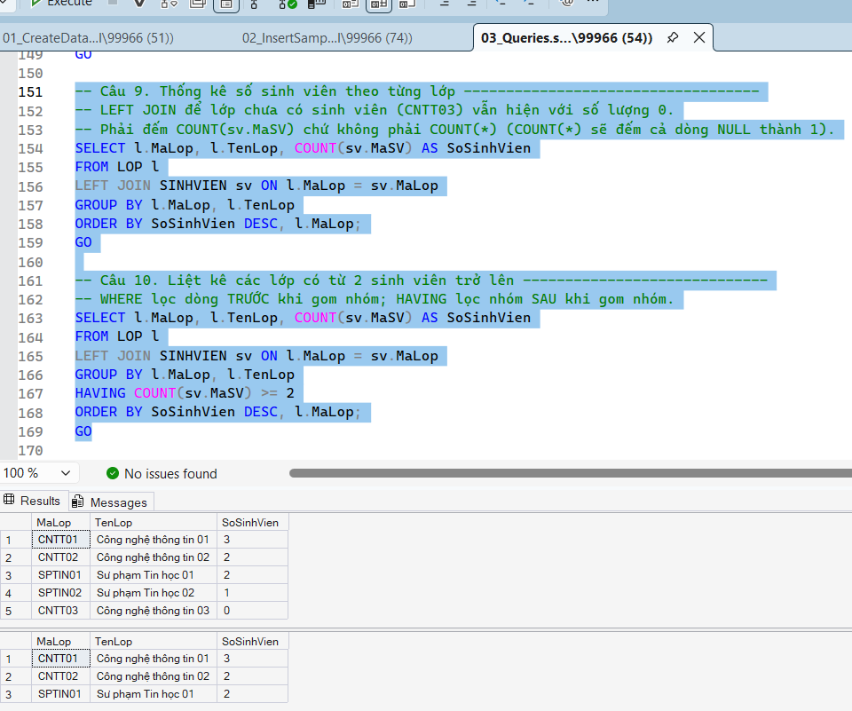
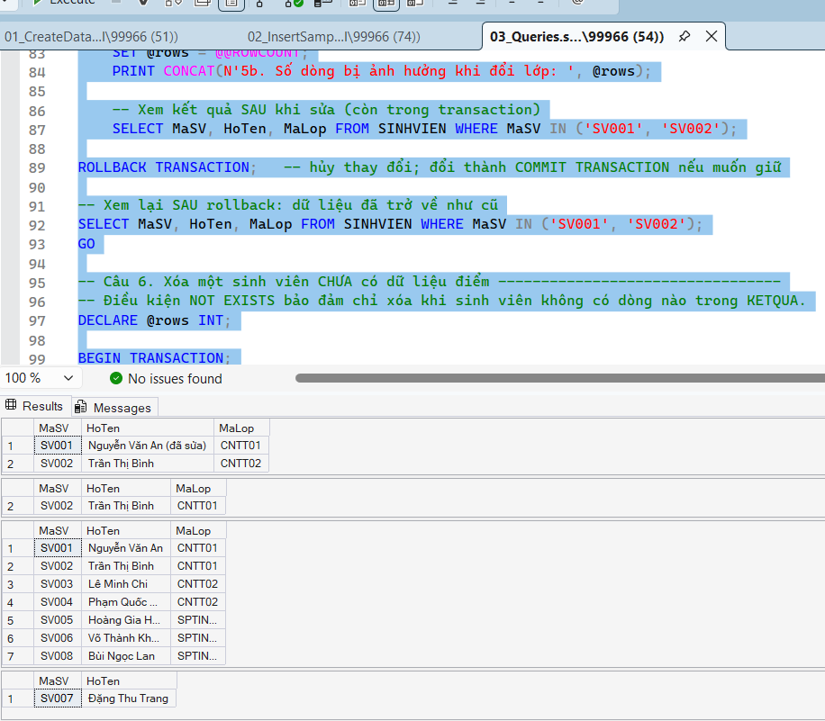
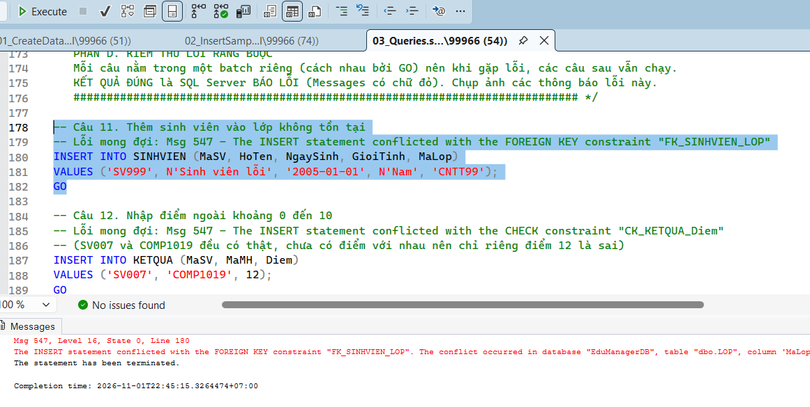
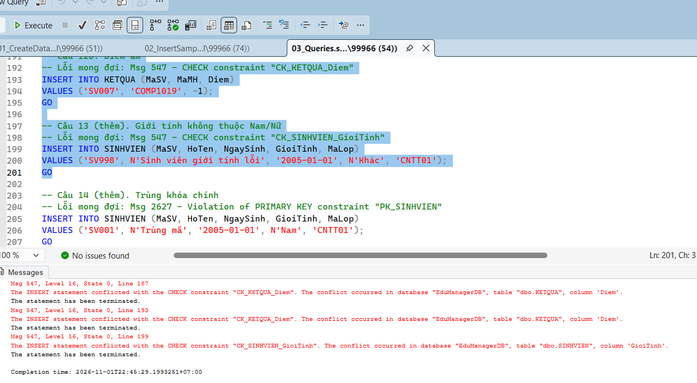
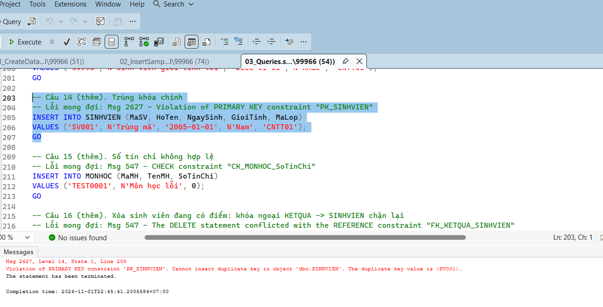

# Bài Lab 10 - Thiết Kế Cơ Sở Dữ Liệu EduManagerDB (SQL Server)

**Học phần:** COMP1019 - Lập trình trên Windows
**Công cụ:** SQL Server, SQL Server Management Studio (SSMS), T-SQL

## Mô tả
Cơ sở dữ liệu quản lý sinh viên gồm 6 bảng KHOA, LOP, SINHVIEN, MONHOC, KETQUA, TAIKHOAN với khóa chính, khóa ngoại và ràng buộc CHECK (giới tính Nam/Nữ, số tín chỉ > 0, điểm 0-10), cùng dữ liệu mẫu và 14 truy vấn.

## Cấu trúc project
- `01_CreateDatabase.sql` — tạo database và 6 bảng
- `02_InsertSampleData.sql` — dữ liệu mẫu (2 khoa, 3 lớp, 6 sinh viên, 4 môn, 8 kết quả, 2 tài khoản)
- `03_Queries.sql` — SELECT, JOIN, GROUP BY, UPDATE, DELETE và các câu kiểm thử ràng buộc

## Cách chạy
1. Mở SSMS, kết nối SQL Server.
2. Chạy lần lượt `01_CreateDatabase.sql`, `02_InsertSampleData.sql`, `03_Queries.sql`.
3. Chạy các câu 11-14 riêng từng câu vì chúng cố ý gây lỗi.

## Kết quả

### 1. Object Explorer
Database EduManagerDB có đủ 6 bảng.

### 2. Sinh viên kèm lớp và khoa
Kết quả JOIN SINHVIEN - LOP - KHOA.

### 3. Điểm và điểm trung bình
Điểm từng môn của sinh viên và điểm trung bình mỗi sinh viên (GROUP BY).

### 4. Thống kê theo lớp
Số sinh viên mỗi lớp và các lớp có từ 2 sinh viên trở lên (HAVING).

### 5. UPDATE và DELETE
Cập nhật họ tên SV001. Lệnh xóa sinh viên chưa có điểm trả về 0 dòng vì SV003 và SV006 đều đã có điểm; muốn thấy xóa thành công, thêm một sinh viên chưa có điểm rồi xóa.

### 6. Lỗi khóa ngoại
Thêm sinh viên vào lớp `CNTT99` bị chặn bởi FK_SINHVIEN_LOP.

### 7. Lỗi CHECK điểm
Nhập điểm 12 bị chặn bởi CK_KETQUA_Diem. Giới tính `Khác` bị chặn bởi CK_SINHVIEN_GioiTinh.

### 8. Lỗi khóa chính
Thêm trùng mã `SV001` bị chặn bởi ràng buộc PRIMARY KEY.

