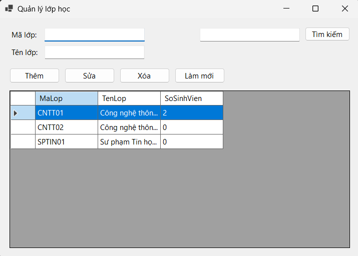
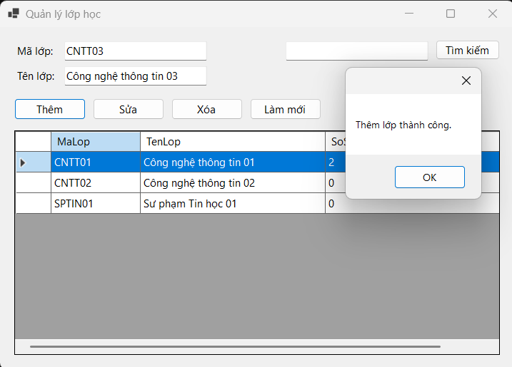
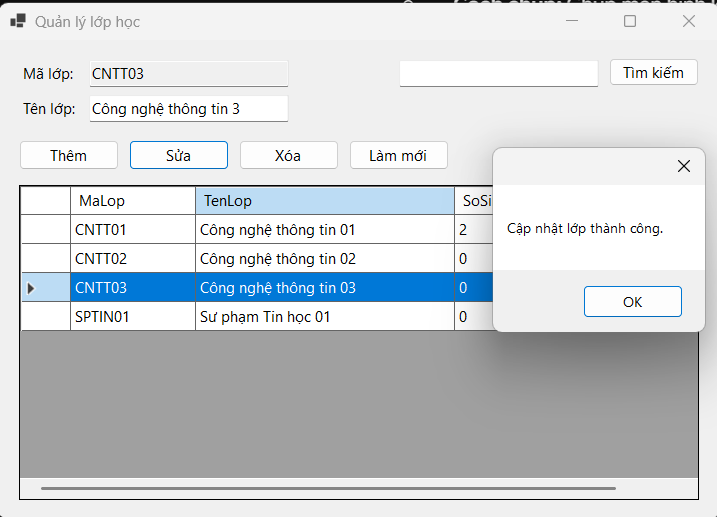
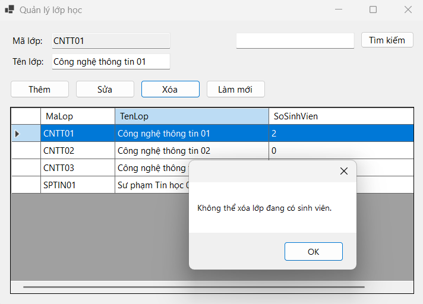
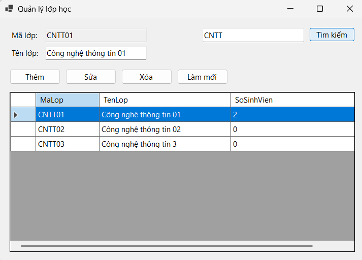
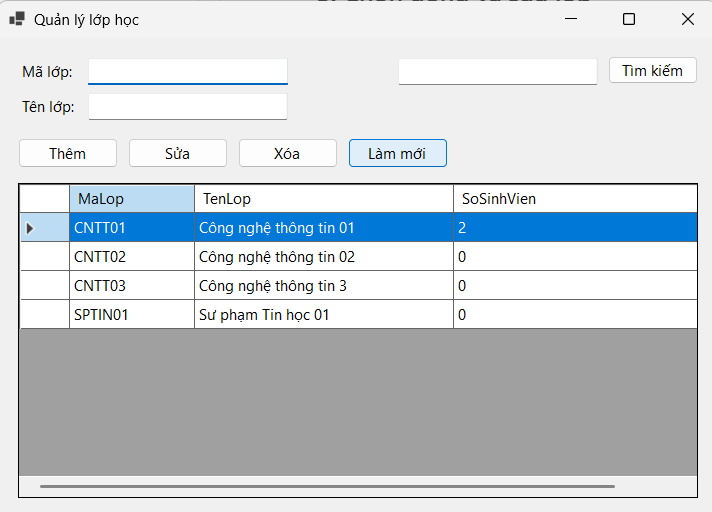

# Bài Lab 11 - ADO.NET và CRUD Với SQL Server (FrmLop)

**Học phần:** COMP1019 - Lập trình trên Windows
**Công cụ:** Visual Studio 2022+ (có workload .NET desktop development), Windows Forms App (.NET 8), C#, Microsoft.Data.SqlClient, SQL Server

## Mô tả
Form quản lý lớp học kết nối SQL Server bằng ADO.NET: hiển thị lớp kèm số sinh viên, thêm, sửa, xóa, tìm kiếm. Mọi câu SQL nhận dữ liệu người dùng đều dùng `SqlParameter`. Click một dòng sẽ khóa ô Mã lớp (khóa chính), bấm **Làm mới** để mở khóa.

## Cấu trúc project
- `Program.cs` — điểm khởi chạy
- `FrmLop.cs` — giao diện và xử lý CRUD
- `EduManagerDB.sql` — script tạo database, bảng LOP và SINHVIEN, dữ liệu mẫu

## Cách chạy
1. Chạy `EduManagerDB.sql` trong SSMS.
2. Mở `COMP1019_Buoi11_Lab11.csproj` bằng Visual Studio (tự restore Microsoft.Data.SqlClient).
3. Kiểm tra connection string trong `FrmLop.cs`, nhấn F5.
4. Connection string đang dùng: `Data Source=.;Initial Catalog=EduManagerDB;Integrated Security=True;TrustServerCertificate=True` (SQL Express đổi thành `Data Source=.\SQLEXPRESS`).

## Kết quả

### 1. Load dữ liệu từ SQL Server
Mở Form, DataGridView hiển thị danh sách lớp và số sinh viên.

### 2. Thêm lớp
Thêm `TEST01 - Lớp test` thành công. Thiếu mã hoặc tên lớp báo nhập đủ; trùng mã `CNTT01` báo "Mã lớp đã tồn tại."

### 3. Chọn dòng và sửa lớp
Click dòng, dữ liệu lên TextBox (ô mã bị khóa); đổi tên và nhấn Sửa thì cập nhật thành công.

### 4. Xóa lớp
Xóa `TEST01` (chưa có sinh viên) thành công sau khi xác nhận. Xóa `CNTT01` báo "Không thể xóa lớp đang có sinh viên."

### 5. Tìm kiếm
Từ khóa `CNTT` hiển thị các lớp phù hợp (LIKE với parameter).

### 6. Làm mới
Xóa nội dung TextBox, mở khóa ô mã và load lại dữ liệu.

