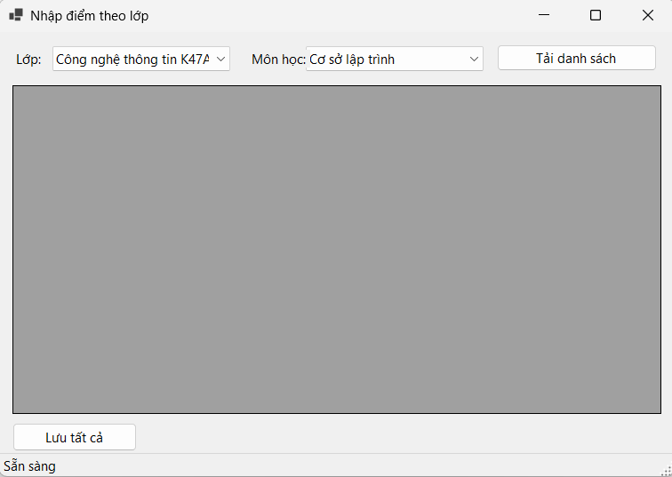
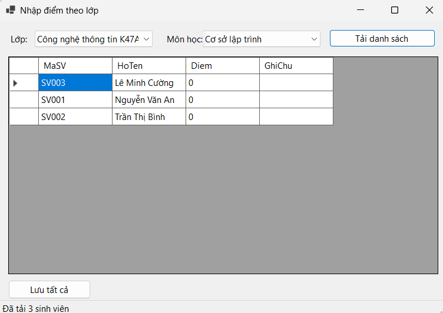
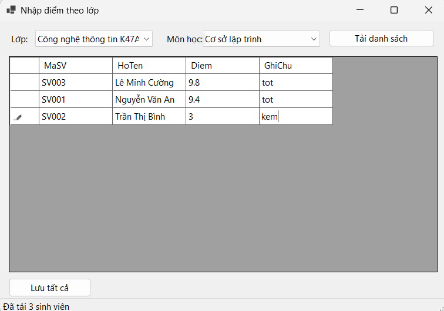
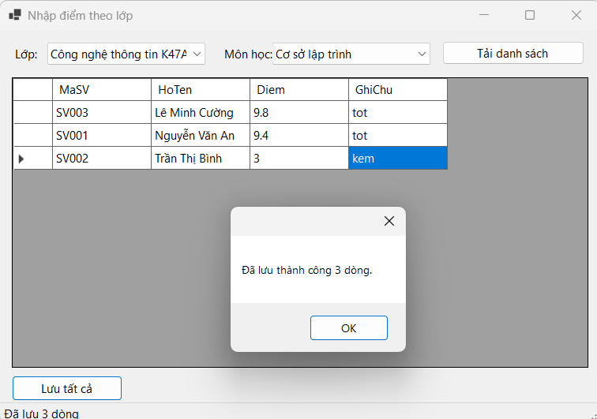
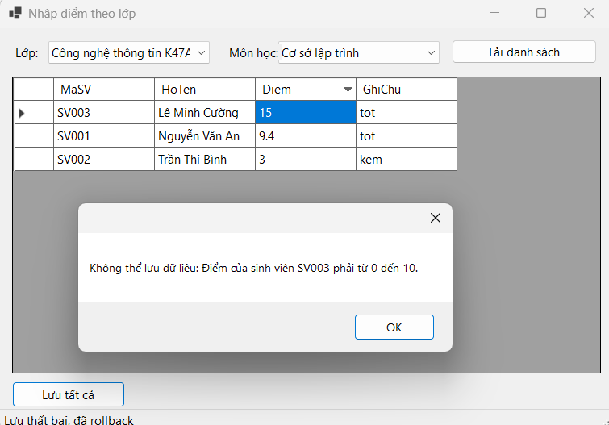

# Bài Lab 12 - Data Binding, Stored Procedure và Transaction

**Học phần:** COMP1019 - Lập trình trên Windows
**Công cụ:** Visual Studio 2022+ (có workload .NET desktop development), Windows Forms App (.NET 8), C#, Microsoft.Data.SqlClient, SQL Server

## Mô tả
Form nhập điểm theo lớp: chọn lớp và môn, tải danh sách sinh viên (kèm điểm nếu đã có), nhập/sửa Diem và GhiChu rồi **Lưu tất cả** trong một transaction. Có dòng lỗi thì rollback toàn bộ.

## Cấu trúc project
- `Database/QLSinhVienLab12.sql` — tạo database, bảng, dữ liệu mẫu, 4 stored procedure
- `DAL/Database.cs` — connection string
- `DAL/KetQuaDAL.cs` — truy cập database, SaveAll dùng transaction
- `Forms/FrmNhapDiemTheoLop.cs` — giao diện, binding, validation

## Cách chạy
1. Chạy `Database/QLSinhVienLab12.sql` trong SSMS.
2. Mở `QLSinhVienLab12.csproj` bằng Visual Studio, chỉnh connection string trong `DAL/Database.cs` nếu cần.
3. Nhấn F5.

## Kết quả

### 1. Load ComboBox
Khi mở Form, ComboBox lớp và môn học được binding từ stored procedure.

### 2. Tải danh sách sinh viên
Chọn lớp, môn và nhấn **Tải danh sách**, lưới hiển thị MaSV, HoTen, Diem, GhiChu (sinh viên chưa có điểm hiện 0).

### 3. Trước khi lưu
Nhập điểm và ghi chú cho các sinh viên, chụp trạng thái lưới và bảng KETQUA trong SSMS.

### 4. Lưu thành công
Nhấn **Lưu tất cả**, thông báo số dòng đã lưu; bảng KETQUA trong SSMS cập nhật (dòng cũ UPDATE, dòng mới INSERT).

### 5. Điểm không hợp lệ và rollback
Nhập điểm `15`, chương trình báo điểm phải từ 0 đến 10 và không dòng nào được lưu.

