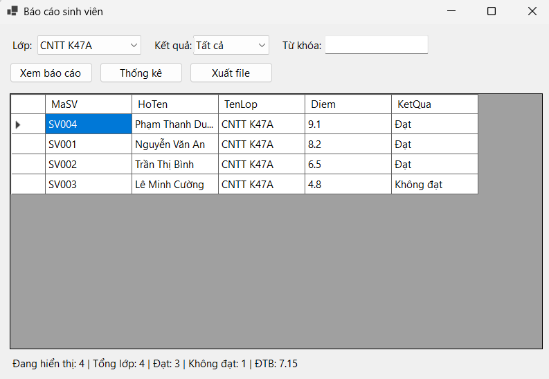
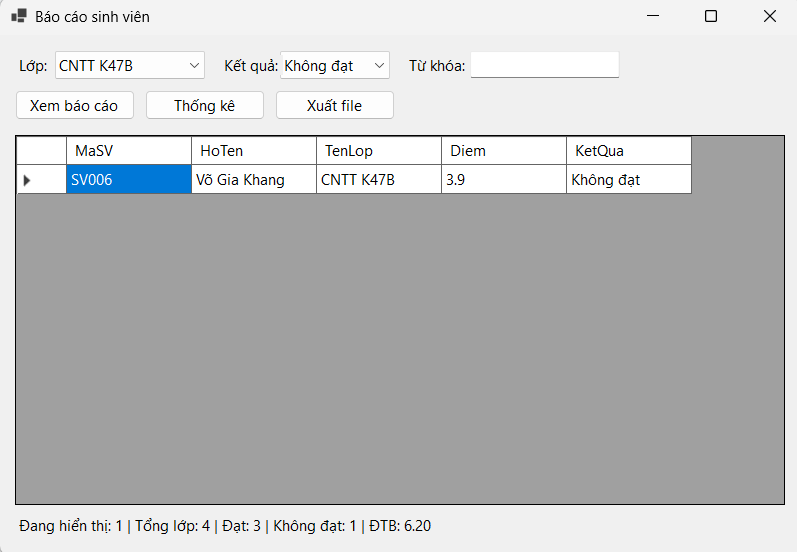
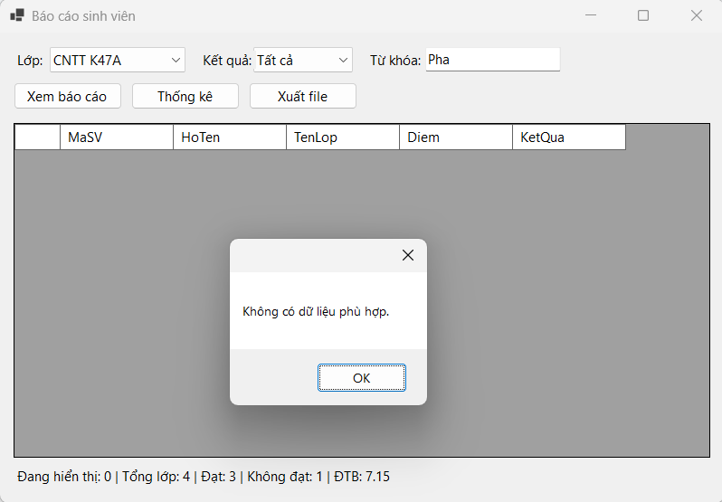
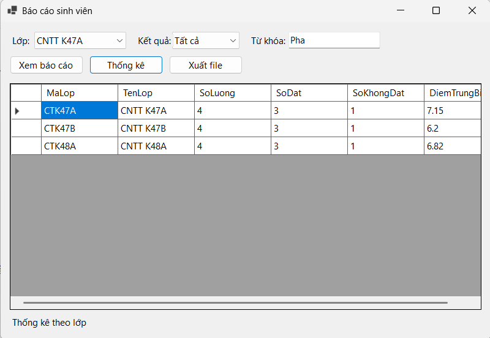
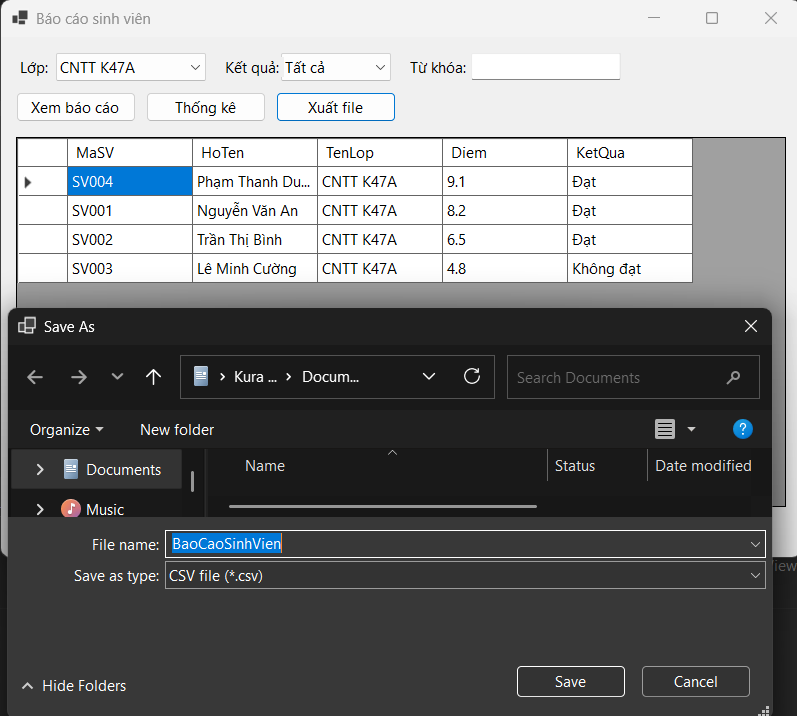

# Bài Lab 13 - Báo Cáo Sinh Viên Bằng LINQ

**Học phần:** COMP1019 - Lập trình trên Windows
**Công cụ:** Visual Studio 2022+ (có workload .NET desktop development), Windows Forms App (.NET 8), C#

## Mô tả
Module báo cáo danh sách sinh viên theo lớp: lọc theo lớp, kết quả và từ khóa, sắp xếp giảm dần theo điểm, thống kê theo lớp bằng LINQ (`Where`, `OrderByDescending`, `ThenBy`, `Select`, `GroupBy`, `Count`, `Average`) và xuất CSV/TXT. Dữ liệu mẫu gồm 12 sinh viên thuộc 3 lớp.

## Cấu trúc project
- `Program.cs` — điểm khởi chạy
- `Models/SinhVien.cs` — model, KetQua là thuộc tính chỉ đọc
- `Forms/FrmBaoCaoSinhVien.cs` — TaoDuLieuMau, LoadComboBox, XemBaoCao, CapNhatThongKe, thống kê, xuất file

## Cách chạy
1. Mở `StudentReportDemo.csproj` bằng Visual Studio.
2. Nhấn F5 để build và chạy.

## Kết quả

### 1. Giao diện và báo cáo mặc định
Mở Form, lớp đầu tiên được chọn; lưới sắp xếp giảm dần theo điểm, nhãn hiển thị tổng, số đạt, số không đạt và ĐTB.

### 2. Lọc theo kết quả
Chọn lớp CNTT K47B và kết quả Không đạt, chỉ còn Võ Gia Khang (3.9).

### 3. Tìm theo từ khóa
Gõ từ khóa theo mã hoặc họ tên; từ khóa không có kết quả hiện "Không có dữ liệu phù hợp."

### 4. Thống kê theo lớp
Nhấn **Thống kê**, mỗi lớp 4 sinh viên kèm số đạt, không đạt và điểm trung bình (K47A: 7.15, K47B: 6.2).

### 5. Xuất file CSV
Nhấn **Xuất file**, lưu `BaoCaoSinhVien.csv` rồi mở file kiểm tra (UTF-8, mở được bằng Excel).

